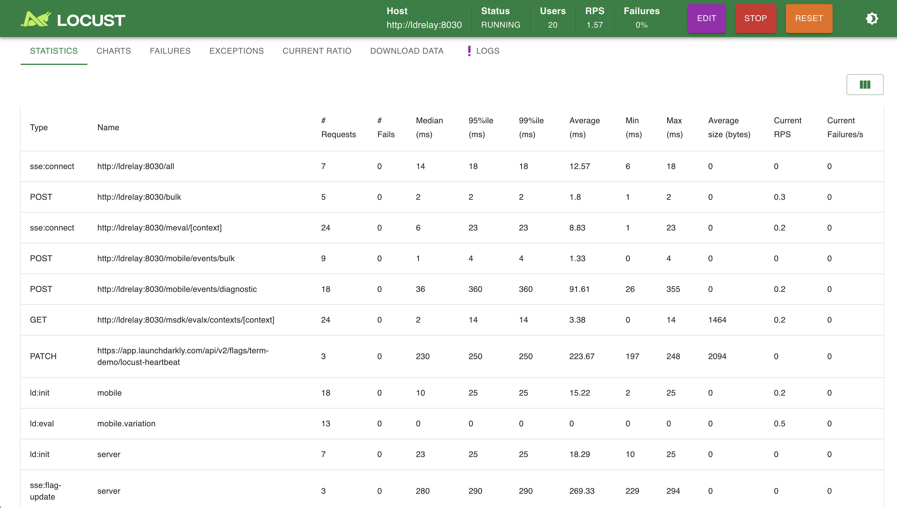

# LD-Relay Locust File

This is a locust file meant to emulate the load of launchdarkly server and mobile clients.

# Setup

## Prerequisites

If you are running the testing infrastructure outside of Docker you will need to install the dependencies. This project utilizes `Python 3`, and `Locust 2.10.1`. You can install the required version of Locust with:

```
pip install locust==2.10.1
```

As with many Python projects you will also need to install the dependencies listed in `requirements.txt`. Enter the `locust` directory and run:

```
pip install -r requirements.txt
```

## Optional: Configure a flag heartbeat

This will allow you gather metrics on how long it takes for a flag to propogate to clients. If you do not follow these steps, you will not get these metrics in Locust but the tests will still run.

- Create a flag with the key `locust-heartbeat` with the type number with two variations
- Create an API key that can modify this flag (see the example token policy below)

## Modify locustfile.py

First off, take a look at `launchdarkly_locust.py`, this file defines the `LaunchDarklyLocust` and `LaunchDarklyMobileLocust` classes that you will be basing your locusts on.

Now open up `locustfile.py`. You'll see a couple of task sets and locusts that you can modify. Simply edit the task sets to emulate the behavior of your users. The example ones just initialize the client and evaluate random flags.

If you want to modify the client settings, just set the properties you'd normally pass to `LDClient.Config` as properties on the `LaunchDarklyBasicServer` and `LaunchDarklyBasicMobile` classes.

Feel free to create as many new task sets and locust subclasses as you want to define different classes of users and behavior. You can define what percentage of users will use each behavior using the `weight` property on the locust class or task sets.

For more information, [read this guide](https://docs.locust.io/en/stable/writing-a-locustfile.html)


## Setup your environment variables

Configure your environment variables like so:

```
LAUNCHDARKLY_MOBILE_KEY=mob-xxxx
LAUNCHDARKLY_SDK_KEY=sdk-xxxx
LAUNCHDARKLY_HEARTBEAT_PROJECT=my-proj-key
LAUNCHDARKLY_HEARTBEAT_API_KEY=api-xxxx
LAUNCHDARKLY_BASE_URI=http://ldrelay:8030
LAUNCHDARKLY_EVENTS_URI=http://ldrelay:8030
LAUNCHDARKLY_STREAM_URI=http://ldrelay:8030
LAUNCHDARKLY_MOBILE_STREAM_URI=http://ldrelay:8030
```

You can also set the `sdk_key` properties on each locust class instead:

```python

class MyLocust(LaunchDarklyMobileLocust):
  sdk_key="mob-xxx"
  # or use a different environment variable
  sdk_key=os.environ.get('SOME_OTHER_ENV')
```

## Running the tests

- Run locust with `python -m locust -f locustfile.py`
- Open `https://localhost:8089` and enter your desired users and set the host to your instance of LD-Relay

## Running in Docker

```
docker build -t locust-ld-relay .
docker run -p 8089:8089/tcp -e TARGET_URL=http://ldrelay:8030 --env-file=env locust-ld-relay:latest
```

## Locally testing with Docker compose

A simple `docker-compose.yml` is provided for local testing. This is the quickest way to get started, however it will not likely be wholly representative of your infrastructure. To get started set the required environment variables `LAUNCHDARKLY_SDK_KEY`, and `LAUNCHDARKLY_MOBILE_KEY`. The variables `LAUNCHDARKLY_HEARTBEAT_PROJECT`, and ` LAUNCHDARKLY_HEARTBEAT_API_KEY` are supported but optional.

Once your environment is configured run `docker-compose up`, and connect to `http://localhost:8089` in your browser.

## Running in Distributed mode

You can test with large amounts of users by using multiple locust nodes. Simply configure the masters and slaves with the following env variables:

### Master

```
LOCUST_MODE=master
```

Be sure to expose port 5557-55578 to your slave nodes

### Slaves

```
LOCUST_MODE=slave
LOCUST_MASTER_HOST=<hostname of master>
```

For more information, refer to [Locust Documentation](https://docs.locust.io/en/stable/running-locust-docker.html)


## FAQ

### Why is the RPS so low?

Users don't equate to requests in Locust. The number of users is the number of instances of the Locust classes defined in your locustfile. It will make as many requests as they make while running.


# Additional Metrics

You can get additional metrics from LD-Relay using the prometheus support in LD-Relay along with the prometheus node exporter.

You can also import stats from Locust into prometheus using [this exporter](https://github.com/ilsken/locust_exporter) which is also available on docker hub under [tarqld/locust_exporter](https://hub.docker.com/r/tarqld/locust_exporter)


# Locust Api Token Policy

Below is an inline policy that would allow the token you generate to update the `locust-heartbeat` flag in any of your projects

```
[
  {
    "resources": [
      "proj/*:env/*:flag/locust-heartbeat"
    ],
    "actions": [
      "updateFlagVariations"
    ],
    "effect": "allow"
  }
]
```
